# FaceWatch

**Real-time face watcher for homes, shops and small workplaces.**
FaceWatch uses a camera to recognise people you have saved, logs when they arrive and leave, and sends alerts to your phone. It runs on your own computer, so your photos and data stay with you.

---

## Screenshots

| Live | Dashboard |
|------|-----------|
| 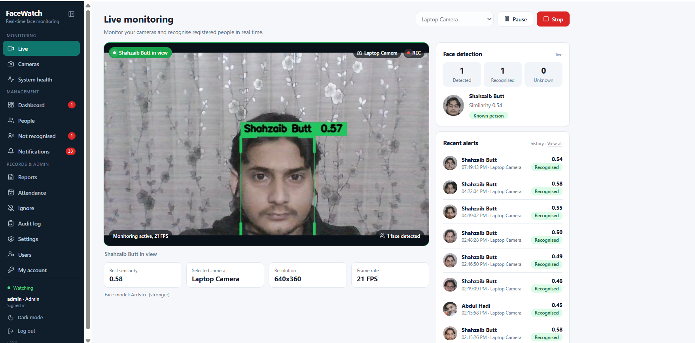 | 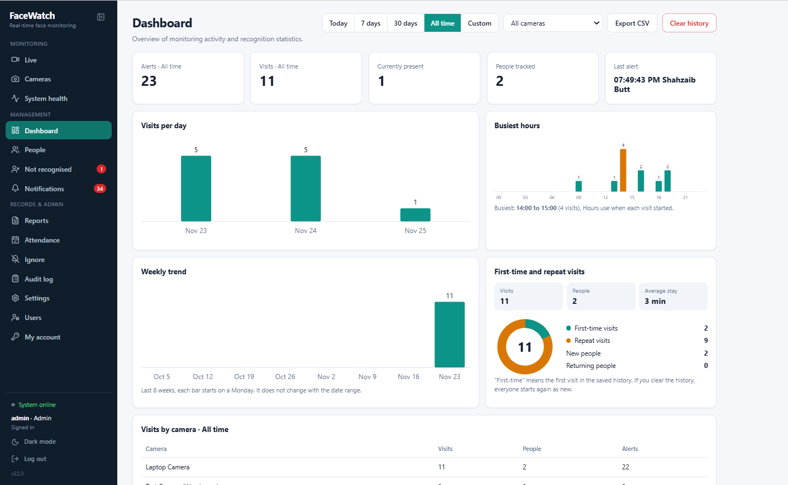 |

| People | Not recognised |
|--------|----------------|
| 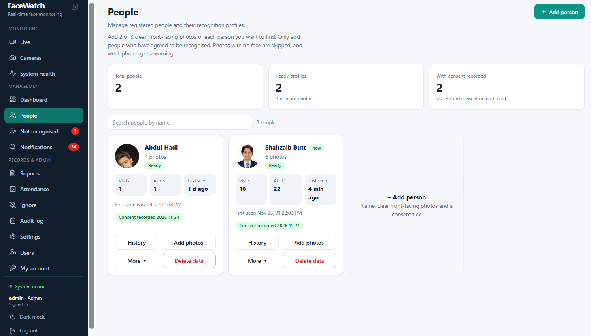 | 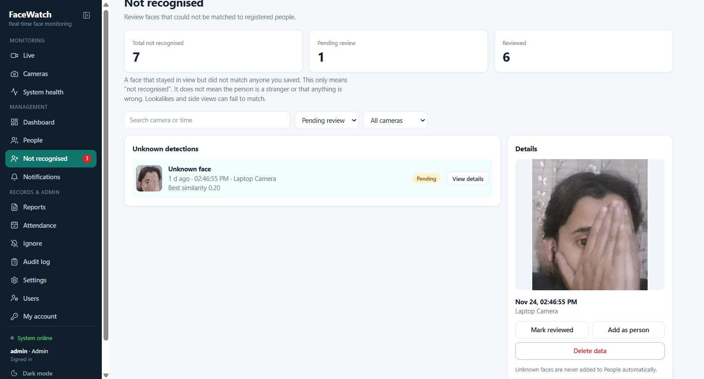 |

| Reports | Attendance |
|---------|------------|
| 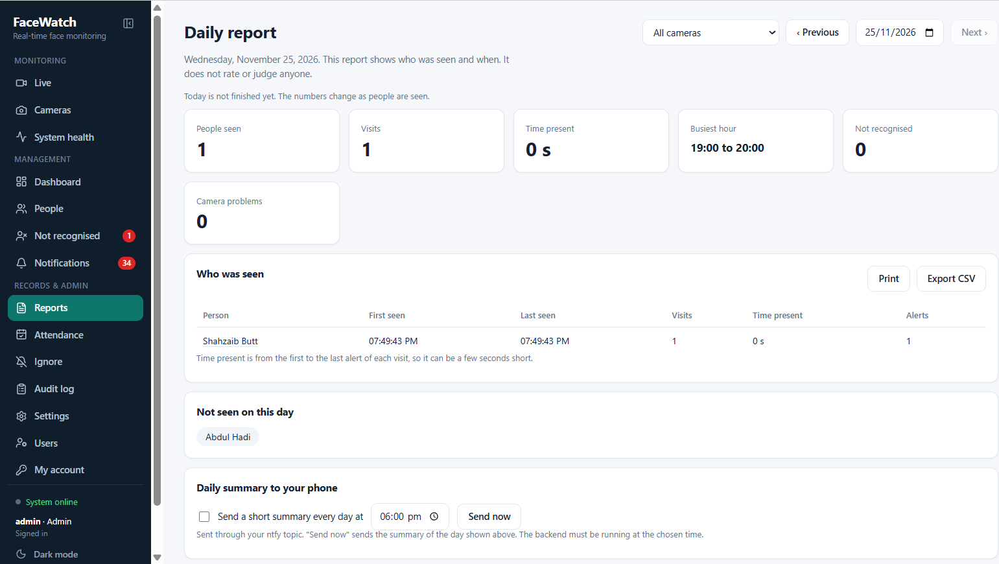 |  |

| Cameras | Notifications |
|---------|---------------|
| 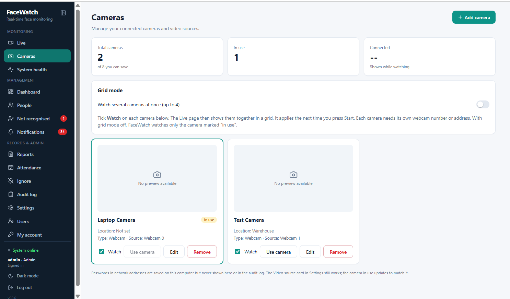 | 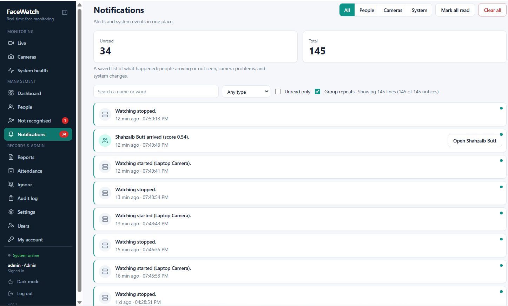 |

| Settings | System health |
|----------|---------------|
| 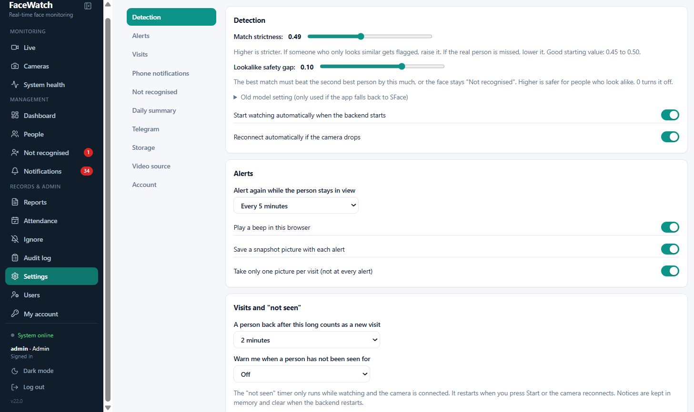 | 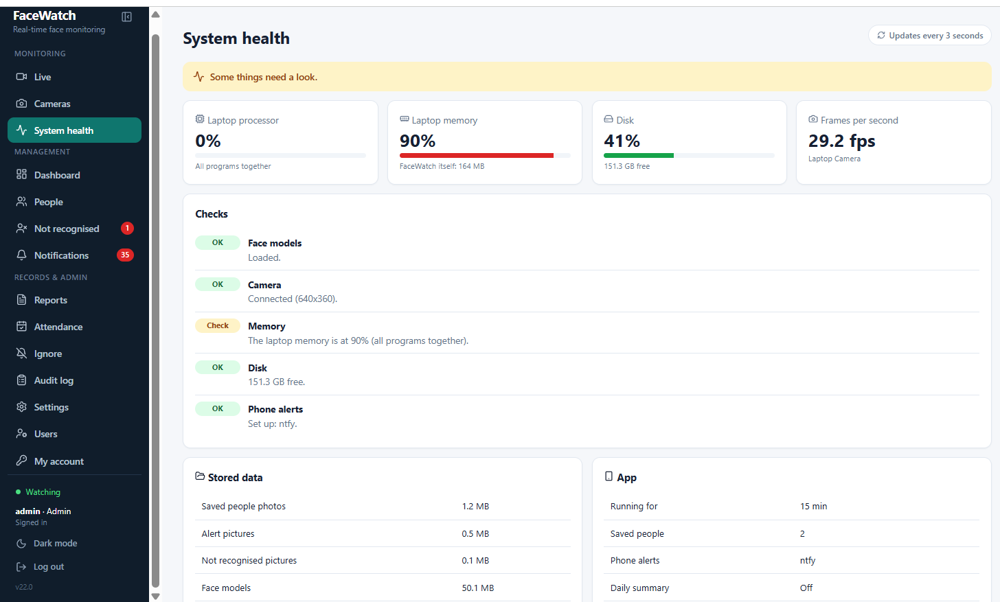 |

| Audit log | Users |
|-----------|-------|
| 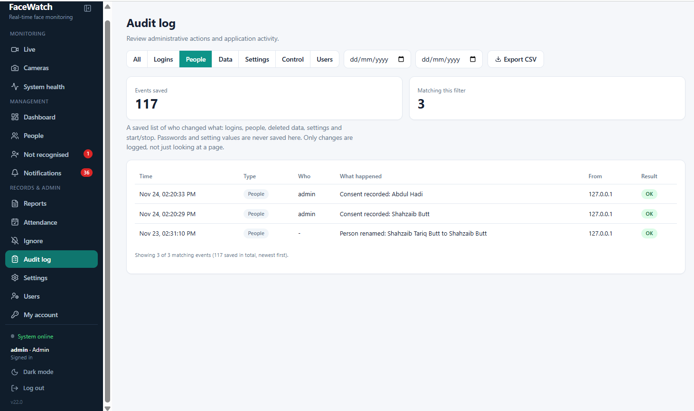 | 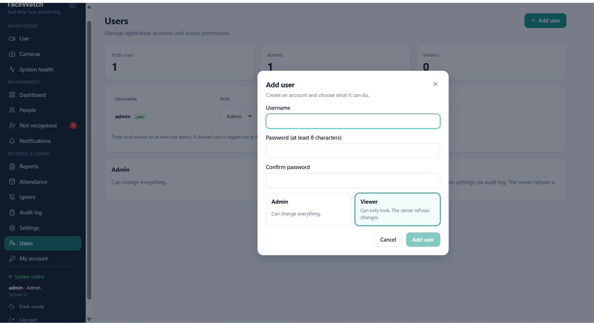 |

| Dark mode | Phone view |
|-----------|------------|
| 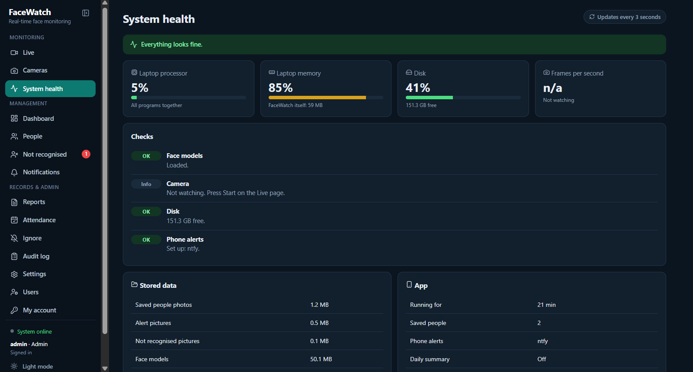 | 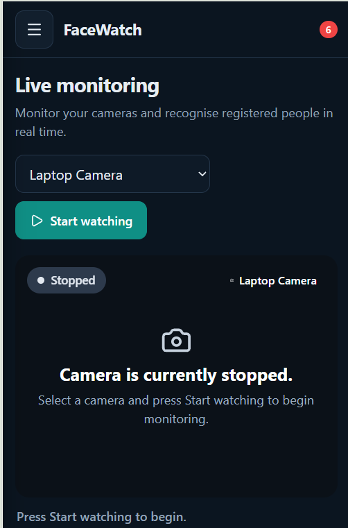 |

---

## Features

**Live watching**
- Real-time face detection and recognition from a webcam, USB camera, video file or network camera (phone app, IP camera, RTSP)
- Live page with camera picture, FPS, best match score and recent alerts
- Grid mode: watch up to 4 cameras at once (a person seen by two cameras counts as one visit)
- Dark and weak-light frames are brightened before matching

**Recognition**
- ArcFace (MobileFaceNet) model for matching, with SFace as an automatic fallback
- Adjustable match strictness
- "Lookalike safety gap": the best match must beat the second best by a set margin, or the face stays "Not recognised"
- Faces that match nobody are saved as "Not recognised" events (never called "suspicious"). You can review them, mark them reviewed, delete them or add them as a new person

**Alerts and notifications**
- Notification centre (people, cameras, system), saved across restarts
- Phone alerts through [ntfy](https://ntfy.sh) and optional Telegram
- Alerts for arrival, "not seen for a while" and not recognised faces
- "Ignore" a person for a number of hours

**Dashboard, reports and attendance**
- Dashboard with Today / 7 days / 30 days / All time / Custom date range
- Visits per day, busiest hours, weekly trend, first-time vs repeat visits
- Daily report (print, CSV export) and an optional end-of-day summary sent to your phone
- Workplace attendance: departments, shifts, first in / last out, late and absent, CSV export
- Per-camera views and filters

**Security and privacy**
- Login with two roles: **Admin** (can change everything) and **Viewer** (read only)
- Audit log of logins, people added or removed, data deleted and settings changed
- Consent flag per person, and "Delete all data of this person"
- Photos and secrets are stored locally in `backend/data/`, which is not uploaded to GitHub

**Other**
- System health page (model, camera, memory)
- Responsive design for laptop and phone, with dark mode

---

## Tech stack

| Part | Technology |
|------|------------|
| Backend | Python, FastAPI, Uvicorn |
| Face detection and recognition | OpenCV (YuNet detector, ArcFace MobileFaceNet and SFace recognisers) |
| Frontend | React, Vite |
| Storage | Local JSON files and image folders (no database server needed) |
| Alerts | ntfy, Telegram |

---

## Project structure

```
facewatch/
├── backend/
│   ├── app/
│   │   ├── engine.py        # camera workers, detection, matching, visits
│   │   ├── storage.py       # people, photos, alerts, settings
│   │   ├── main.py          # API routes
│   │   ├── secure.py        # app entry point (run this)
│   │   ├── auth.py          # login and sessions
│   │   ├── users.py         # users and roles
│   │   ├── audit.py         # audit log
│   │   ├── cams.py          # camera management and grid mode
│   │   ├── notify.py        # ntfy and Telegram
│   │   ├── privacy.py       # consent and data deletion
│   │   ├── quiet.py         # "Ignore" rules
│   │   ├── report.py        # daily report and summary
│   │   ├── attendance.py    # shifts and attendance
│   │   └── extras.py        # analytics and notifications
│   ├── data/                # created at runtime, NOT in Git
│   ├── model_test.py        # compares SFace and ArcFace, downloads ArcFace
│   └── requirements.txt
├── frontend/
│   └── src/                 # React pages and components
├── .gitignore
└── README.md
```

---

## Getting started

### Requirements
- Python 3.10 or newer
- Node.js 18 or newer
- A camera (laptop webcam is fine)

### 1. Clone

```bash
git clone https://github.com/<your-username>/facewatch.git
cd facewatch
```

### 2. Backend

```bash
python -m venv .venv
.venv\Scripts\activate          # Windows
# source .venv/bin/activate     # Linux / macOS

cd backend
pip install -r requirements.txt
```

### 3. Download the ArcFace model (once)

```bash
python model_test.py
```

This downloads about 120 MB once and keeps only the small model file (`w600k_mbf.onnx`, 13 MB) in `backend/data/models/`. If the file is missing, FaceWatch falls back to SFace automatically.

### 4. Frontend

```bash
cd ../frontend
npm install
npm run build
```

### 5. Run

```bash
cd ../backend
python -m uvicorn app.secure:app --host 0.0.0.0 --port 8000
```

Open **http://localhost:8000** on the laptop.
To open it on your phone (same Wi-Fi), use `http://<laptop-ip>:8000`.

On the first start you create the admin login. For development you can also run `npm run dev` in `frontend/` and open http://localhost:5173 while the backend is running.

---

## How to use

1. Go to **People**, add a person and upload 3 to 5 clear, front-facing photos (different light, with and without glasses).
2. Go to **Live** and press **Start**.
3. Alerts appear on Live, in Notifications and on your phone.
4. In **Settings**, set your ntfy topic (install the free ntfy app and subscribe to the same topic), then press "Send test message".
5. Use **Dashboard**, **Reports** and **Attendance** to review who was seen and when.

### Tuning matching
- **Match strictness** (default 0.45 for ArcFace): raise it if lookalikes get wrong names, lower it if real people are missed.
- **Lookalike safety gap** (default 0.05): raise it for people who look alike. 0 turns it off.
- Good photos matter more than any setting. Add more photos for anyone with low scores.

---

## Privacy and ethics

- Everything runs locally. Nothing is sent to a cloud service except the alerts you set up (ntfy or Telegram).
- Only save people who agree to be recognised. Each person has a consent flag, and you can delete all of a person's data at any time.
- "Not recognised" only means the face did not match anyone saved. It does not mean the person is a stranger or that anything is wrong.
- Face recognition can make mistakes, especially with weak cameras, bad light, side views and lookalikes. Do not use it as the only basis for a serious decision.
- Keep your ntfy topic secret. Anyone who knows it can read your alerts.
- Never commit `backend/data/` (it holds passwords, settings, photos and logs). It is already in `.gitignore`.

---

## Known limits

- Tested mainly with a laptop webcam and one USB camera. Grid mode with real face models on slower laptops may reduce FPS.
- Live grid picture supports at most 4 cameras, and non-English camera names may show as "?" in the picture.
- The daily summary and "not seen" alerts only work while the backend is running.
- Accuracy was checked on a small test set (2 people, 10 photos). Test with your own people and cameras.

---

## Roadmap

- Stronger face detector for small or angled faces
- Make the consent flag stop recognition of that person
- Shifts that cross midnight in Attendance
- Notice when only one of several cameras is down
- Packaged `.exe` for computers without Python
- Start with Windows and run in the background

---

## Author

**Shahzaib Tariq**

## License

Add a license here (for example MIT) before making the repository public.